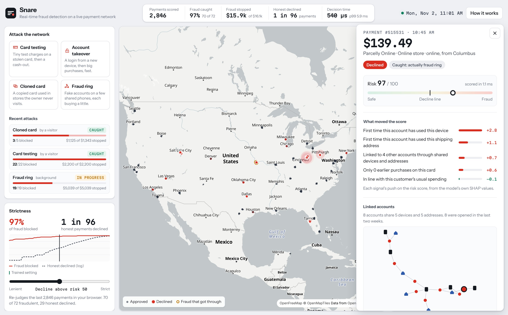
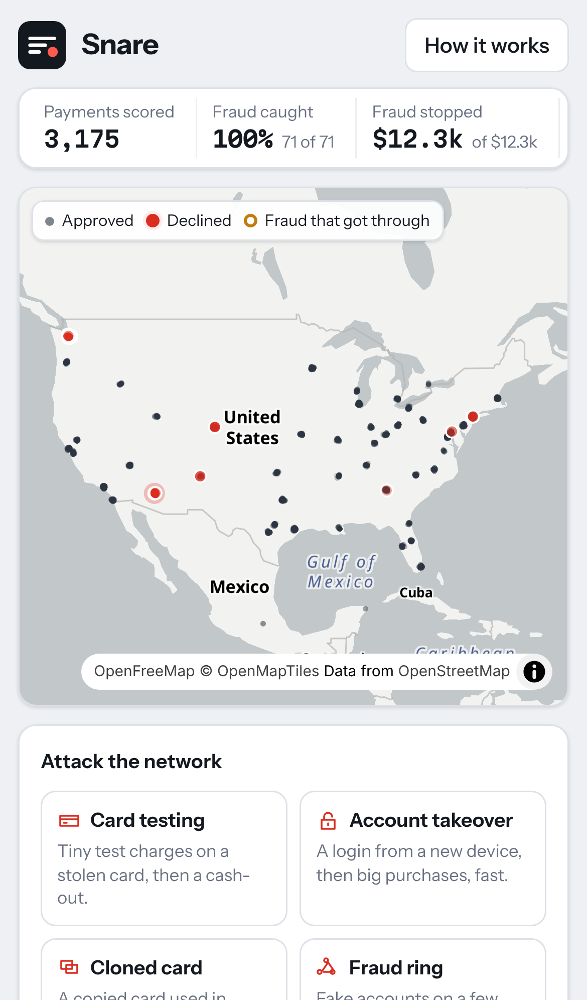

# Snare

Real-time fraud detection on a live payment network. A Python simulation runs
12,000 cardholders shopping across the US, a machine-learning model scores
every payment as it happens, and you can attack the network yourself: launch
card testing, an account takeover, a cloned card or a fraud ring, and watch
the model catch it and explain why.





## What it does

**A live payment network.** Customers buy groceries near home, pay for
subscriptions, travel, get new phones and order food at 2am. Every payment
lands on the map where it happened. Approved payments are small dots, declined
ones flash red, and fraud that got through is ringed in amber, so misses are as
visible as catches.

**Attack it.** Four buttons launch real attacks into the shared network, built
from the same playbooks the model was trained against:

| Attack | What it looks like |
| --- | --- |
| Card testing | A stolen card checked with tiny purchases, then cashed out |
| Account takeover | A login from a new device, then high-value items, fast |
| Cloned card | A copied card used in stores while the owner shops at home |
| Fraud ring | Up to two dozen fake accounts on a few shared phones, each buying a little |

Everyone watching sees the same network, so an attack launched by one visitor
shows up for all of them.

**Every decision explained.** Click any payment to see its risk score, the
signals that moved it ("4 tiny charges in the last 10 minutes", "first time
this phone has been used", "1,800 miles from the last store visit"), and for
rings, the graph of linked accounts. Reasons come from the model's own SHAP
values, not a separate guess.

**Strictness slider.** Every fraud system trades blocked fraud against blocked
customers. The slider moves the decline threshold and re-judges every payment
on screen, with the trade-off curve beside it.

## Results

Measured on the last 15 days of a 100-day simulation, which the model never
saw during training. Both models are set to decline about 1 in 200 honest
payments; the rules decline more than twice that and still miss most fraud.

| | Snare | Without the account graph | Hand-written rules |
| --- | --- | --- | --- |
| Fraudulent payments blocked | **94.6%** | 93.2% | 29.7% |
| Fraud dollars blocked | **95.2%** | 93.9% | 22.2% |
| Attacks stopped at least once | **98.2%** | 96.5% | 42.5% |
| Declines that were really fraud | **35.2%** | 36.3% | 7.0% |
| Honest payments declined | **1 in 204** | 1 in 218 | 1 in 91 |
| PR-AUC | **0.920** | 0.896 | 0.023 |

Blocked, by kind of attack:

| | Snare | Without the account graph |
| --- | --- | --- |
| Card testing | 99.7% | 99.5% |
| Account takeover | 100.0% | 99.0% |
| Cloned card | 72.2% | 68.9% |
| Fraud ring | 99.0% | 97.1% |

The test set is 366,213 payments, 1,025 of them fraud. Cloned cards
used near the owner's home are the hardest case: nothing about the payment
itself is unusual.

## How it works

```
simulator -> streaming features -> account graph -> LightGBM -> SHAP reasons
```

- **Simulation** (`snare/simulator.py`, `snare/scenarios.py`). A discrete-event
  simulation of customers, households, merchants, devices and networks. Honest
  behaviour includes the things that make fraud hard: travel, new phones,
  shared carrier IPs, gift orders and shopping sprees. Fraud is written to
  blend in: careful card testers, local cloned cards, rings that age their
  accounts first.
- **Streaming features** (`snare/features.py`). 33 features per payment,
  computed in one pass from everything seen *before* it: velocity, amount
  against the card's history, distance and implied travel speed, how long the
  device, network and address have been known. Training and the live server
  run the same code, so there is no look-ahead leakage and no training/serving
  skew. A test checks this directly. The live network rebuilds itself every
  few simulated days so its histories stay in the range the model was trained
  on.
- **Account graph** (`snare/graph.py`). Accounts that share phones or shipping
  addresses are joined with union-find. Carrier IPs are excluded because
  thousands of honest strangers share them.
- **Model** (`snare/train.py`). LightGBM on about 2 million payments with an
  out-of-time split: after a two-week warm-up, train on days 14 to 70, pick
  the threshold on days 70 to 85, report on days 85 to 100. Compared against a hand-written rulebook
  and against the same model without graph features.
- **Serving** (`snare/server.py`, `snare/engine.py`). FastAPI streams scored
  payments over a WebSocket four times a second. Features plus scoring take
  about 0.6 ms per payment (median, one CPU core).

## Running locally

With Docker, one command:

```bash
docker build -t snare . && docker run -p 8000:8000 snare
```

Then open http://localhost:8000.

Without Docker (Python 3.12+ and Node 20+):

```bash
python -m venv .venv
source .venv/bin/activate        # Windows: .venv\Scripts\activate
pip install -r requirements-dev.txt
uvicorn snare.server:app         # API on :8000, ready in about 30 seconds

cd web
npm install
npm run dev                      # app on http://localhost:5173
```

A trained model is included in `models/`. To retrain it from scratch:

```bash
python -m snare.train            # simulate 100 days and train (about 20 minutes)
python -m snare.snapshot         # optional: save a warm network so the server starts instantly
```

```bash
pytest          # tests
ruff check .    # lint
```

## Deploying

The `Dockerfile` builds the web app, simulates the month of history the live
network starts from, and serves everything from one container, so it starts
in seconds even on a small instance.

On Render's free plan: **New > Blueprint**, pick this repo, and `render.yaml`
does the rest. Every push to `main` redeploys. Free instances sleep after 15
minutes without visitors, so the first visit after that takes about a minute.

## Structure

```
snare/          simulation, features, graph, training, model, live engine, API
models/         trained model (gzipped) and its test-set metrics
tests/          simulation, point-in-time features, graph, snapshot, API
web/src/        React app: map, receipt feed, attack console, case view
```
